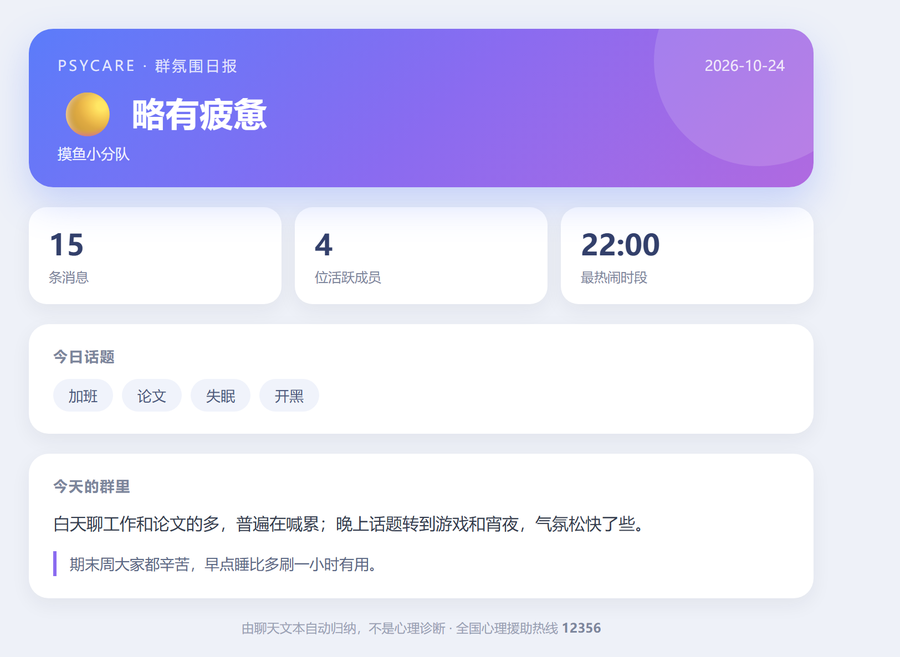
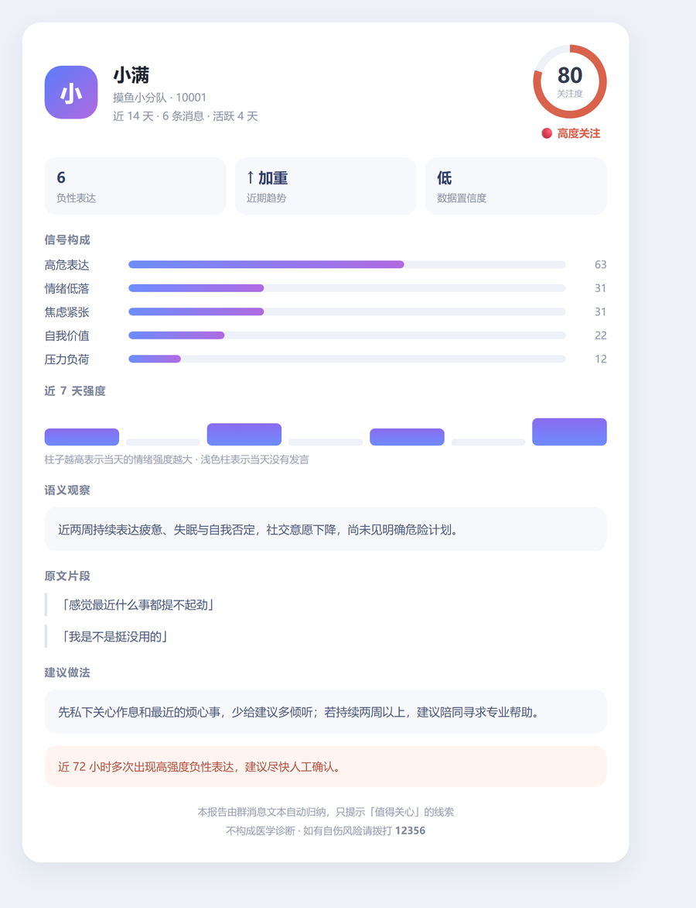
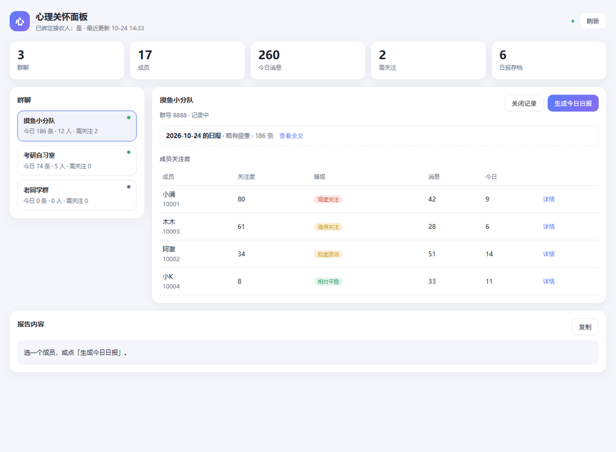

<p align="center"></p>

# 心理关怀 · PsyCare

[](https://astrbot.app)
[](LICENSE)
[](CHANGELOG.md)

> AstrBot 插件：从 QQ 群聊里找出**值得关心**的对话线索，把结论只推给管理员私聊。
> **它不是诊断工具**，输出的是「关注度」和「建议动作」，不是「抑郁症」这种结论。

---

## 它能做什么

- **被动收集**群消息，本地按人聚合成 14 天（可配）的「关注度画像」。
- **两层分析**：
  1. 词频规则层：165 条中文心理风险词条，8 个维度，带否定消解（「我不会自杀」不算）；
  2. 大模型语义层：把采样片段交给 AstrBot 里已配置的模型，要求只输出结构化 JSON，
     归纳「情绪/焦虑/自我价值/睡眠/社交/压力/危机」七个维度。
- **主动提醒**：关注度超过阈值、或出现「想死 / 不想活 / 自残」这类明确危机表达时，
  立刻推送给管理员**私聊**，同一人默认 24 小时只提醒一次。
- **心情曲线**：报告里附最近 7 天的情绪强度走势（`▁▂▅▇█`，`·` 表示当天没说话）。
- **每日群氛围日报**：每天固定时刻自动跑一遍当天群聊，生成两版文案——
  群里的「公开版」只有整体气氛，管理员私聊的「私密版」才点到人。
- **管理员报告**：`/心理报告 @某人` 生成结构化报告（分数、维度条形图、原文片段、建议）。
- **图片卡片**：日报和单人报告都渲染成卡片图（HTML + Jinja2 → PNG），
  T2I 不可用时自动退回文字，不会报错。
- **WebUI 面板**：插件详情页里多一个「心理关怀面板」，看各群今日氛围、成员关注度、
  日报历史，也能一键生成日报、开关某个群的记录。
- **历史留档**：日报存在本地，`/心理历史` 回看最近 7 天。
- **隐私开关**：任何人可 `/心理退出` 停止被记录并清空数据；数据默认 30 天过期。

## 群氛围日报

和「群日常分析」类插件的定时报告对应，只是把「谁最活跃」换成了「今天群里气氛怎么样」：

```
🌙 群氛围日报 · 10-24
━━━━━━━━━━━━━━
消息 186 条 · 活跃 12 人 · 最热闹 21:00
整体气氛：🟡 略有疲惫
今日话题：加班 · 论文 · 开黑

📝 白天聊工作和论文的多，普遍在喊累；晚上话题转到游戏和宵夜，气氛松快了不少。
💡 期末周大家都辛苦，早点睡比多刷一小时有用。

（本报告只观察整体氛围，不评价任何个人；需要帮忙可以私聊管理员）
```

管理员私聊里多一段：

```
👤 建议留意（1 人）
· 小满（10001）80分 高度关注 · 高危表达、情绪低落

🚨 有人达到高度关注，建议今天内私聊确认一下。
```



**公开版永远不含人名、QQ 号、原话和个体判断**——喂给模型的也是去掉昵称的纯文本，
提示词里明确禁止点名。个人层面的东西只走 `/心理绑定` 的私聊。

日报默认 21:30、只发管理员私聊；`daily_target` 可选 `group`（只发群里）、
`both`（群里公开版 + 私聊详细版）。当天消息少于 `daily_min_messages`（默认 5）就不生成。

大群也不用担心上下文：词频层对当天**全部**消息统计，模型只看按时间均匀采样后的 50 条，
相当于把「增量分析」压成一次固定成本；`/心理日报` 可随时手动补一份。

## 图片报告

日报和单人报告都会渲染成 760px 宽的卡片图：渐变头部 + 大号气氛标签 + 统计块 + 维度条，
私密版多一块「建议留意」。实现走 AstrBot 自带的 `html_render`（HTML + Jinja2 → Playwright 截图），
不额外装依赖。

```
templates/
├── daily_card.html    日报卡片（公开版 / 管理员版共用， 控制）
└── report_card.html   单人报告卡片（环形成绩 + 维度条 + 原文片段）
```

- **前提**：AstrBot 里已启用文转图 / T2I。没启用时插件不会报错，
  自动退回文本报告，并在日志里提示一次。
- **开关**：配置 `image_report`（默认 `true`）。
- **预览**：`python scripts/preview_cards.py` 会把两张卡片渲染成 HTML 放在
  `build/preview/`，用浏览器打开就能看效果（脚本内置一个迷你模板渲染器，仅用于预览，
  运行时仍然是 Jinja2）。



## WebUI 面板

插件详情页里会多出一个「心理关怀面板」（`views/dashboard/`），不依赖任何前端构建：

```
views/dashboard/
├── index.html   布局
├── style.css    亮/暗主题跟随 WebUI（data-theme）
└── app.js       通过 window.AstrBotPluginView 调后端
```

面板能做的事：

| 区域 | 内容 |
| --- | --- |
| 顶部统计 | 群数、成员数、今日消息、需关注人数、日报存档数 |
| 左侧群列表 | 今日消息量、成员数、需关注数、开关状态 |
| 右侧成员表 | 关注度、等级、消息数、今日发言，点「详情」拉单人报告 |
| 操作 | 「生成今日日报」立刻跑一次；「开启/关闭记录」直接改群状态 |
| 日报 | 显示最近一份的氛围和全文 |

后端接口（`context.register_web_api`）：

| 方法 | 路由 | 用途 |
| --- | --- | --- |
| GET | `/{plugin}/overview` | 概览：群、成员、今日统计、最近提醒 |
| GET | `/{plugin}/report?group_id=&uid=` | 单人报告全文 |
| POST | `/{plugin}/daily` | 生成当天日报 |
| POST | `/{plugin}/toggle` | 开启 / 关闭某个群 |

需要 AstrBot 支持 `register_web_api`（4.16+）；旧版本会自动跳过注册并写一条日志，
不影响命令和日报。面板只读为主，两个写操作（生成日报、开关群）都会落盘并即时生效。



## 全自动到什么程度

| 环节 | 是否自动 | 说明 |
| --- | --- | --- |
| 接收群消息 | 自动 | 平台每推一条，`on_group_message` 就处理一条 |
| 心情/风险打分 | 自动 | 词频规则每条实时算；模型复核按「新增 12 条 + 冷却 120 分钟」批量触发 |
| 入库与画像 | 自动 | 每 60 秒落盘一次，后台自动清理过期数据 |
| 高危提醒 | 自动 | 分数过线或命中危机词即推送，同一人 24h 内只推一次 |
| 群氛围日报 | 自动 | 每天 `daily_time` 跑一次；离线错过 6 小时内会补跑 |
| 单人详细报告 | 手动 | `/心理报告` 按需生成 |
| 开启群 | 一次性手动 | 管理员发一次 `/心理开关 on`，之后不再需要 |

想让「开启群」也免掉，把配置里的 `require_group_activation` 改成 `false`；
想彻底零打扰，还可以把 `alert_enabled` 和 `daily_enabled` 关掉，只留手动报告。

## 它不做什么

- 不在群里公开任何人的状态（除非管理员显式打开 `allow_group_report`）。
- 不输出疾病诊断，不替代心理咨询或精神科评估。
- 不抓取私聊，不跨群关联同一个人，不把数据上传到除模型提供商以外的地方。

---

## 安装

**方式一：插件市场（推荐）**

在 AstrBot WebUI 的「插件」页搜索「心理关怀」或 `astrbot_plugin_psycare`，点击安装即可。
安装后重载插件。

**方式二：手动安装**

1. 把仓库根目录整个放进 AstrBot 的 `data/plugins/astrbot_plugin_psycare/`。
2. 在 WebUI「插件管理」里重载插件（或重启 AstrBot）。
3. 插件无第三方依赖，不需要 `pip install`。

**方式三：zip 安装**

```bash
python scripts/build_release.py     # 生成 dist/astrbot_plugin_psycare-1.2.0.zip
```

在 WebUI「插件」页上传该 zip 即可。

### 前置条件

- 需要一个**能收到群消息**的适配器。QQ 官方机器人只能收到 @ 它的消息，做不了被动分析；
  请使用 OneBot v11（NapCat / LLOneBot 等）。
- 建议在 AstrBot 里配置好一个对话模型：开启 `llm_analysis` 时才会用到；
  关闭后插件只用本地词库，数据完全不出机器。
- 图片报告需要 AstrBot 已启用文转图（T2I）；WebUI 面板需要 AstrBot ≥ 4.16，
  更低版本会自动跳过面板，其余功能不受影响。

### 第一次使用（3 步）

1. **在群里**由机器人管理员发送 `/心理开关 on` —— 插件默认不会默默分析所有群，
   必须显式开启；成员之后可随时 `/心理退出`。
2. **私聊**机器人发送 `/心理绑定` —— 高危提醒和报告都会发到这个私聊会话。
3. 正常聊天即可，插件自动记录；管理员用 `/心理报告 @某人` 查看报告。

> 「管理员」指 AstrBot 配置里的管理员账号，不是 QQ 群主/管理员。

---

## 命令

| 命令 | 谁可以用 | 说明 |
| --- | --- | --- |
| `/心理帮助` | 所有人 | 查看用法 |
| `/心理状态` | 所有人 | 查看自己被记录了多少条、当前关注度 |
| `/心理退出` | 所有人 | 停止记录并**删除**已存消息 |
| `/心理加入` | 所有人 | 恢复记录 |
| `/心理遗忘` | 所有人 / 管理员 | 删除自己的数据；管理员可加 `@某人` 删他人 |
| `/心理绑定` | 所有人（仅私聊） | 绑定接收提醒的会话 |
| `/心理解绑` | 所有人（仅私聊） | 取消绑定 |
| `/心理报告 @某人` | 管理员 | 生成单人详细报告 |
| `/心理报告 12345678` | 管理员 | 用 QQ 号查询 |
| `/心理概览` | 管理员 | 本群关注度排行 |
| `/心理日报` | 管理员 | 立刻生成当天的群氛围日报 |
| `/心理历史` | 管理员 | 最近 7 天的日报列表 |
| `/心理待办` | 管理员 | 最近的提醒记录 |
| `/心理开关 on/off` | 管理员 | 开启（首次必须）/关闭本群记录 |

---

## 配置要点

完整项见 `_conf_schema.json`，在 WebUI 插件配置页可视化编辑。

| 配置 | 默认 | 说明 |
| --- | --- | --- |
| `enabled` | `true` | 总开关 |
| `require_group_activation` | `true` | 必须由管理员 `/心理开关 on` 才分析该群 |
| `window_days` | `14` | 报告统计窗口 |
| `retention_days` | `30` | 消息保留天数，过期自动删 |
| `llm_analysis` | `true` | 关掉则只用词库，数据不出本机 |
| `llm_min_new_messages` | `12` | 同一人新增多少条才重新调用模型 |
| `alert_threshold` | `75` | 提醒阈值，越低越敏感也越容易误报 |
| `alert_cooldown_hours` | `24` | 同一人提醒冷却 |
| `daily_enabled` | `true` | 每日群氛围日报总开关 |
| `daily_time` | `21:30` | 日报触发时间（本地时间，HH:MM） |
| `daily_target` | `private` | 日报发哪里：`private` / `group` / `both` |
| `daily_min_messages` | `5` | 当天消息少于这个数就不出日报 |
| `image_report` | `true` | 报告渲染成图片；T2I 不可用时自动退回文本 |
| `require_opt_in` | `false` | 打开后必须先 `/心理加入` 才记录 |
| `allow_group_report` | `false` | 打开后报告会直接发到群里（有隐私风险） |
| `care_message_enabled` | `false` | 危机时在群里发一句关心（默认关闭，见下） |
| `include_quotes` | `true` | 报告里是否附原文片段（截断到 36 字） |

**关于 `care_message_enabled`**：打开后，检测到危机表达时机器人会在群里 @ 当事人说一句关心的话。
出发点是好的，但可能让对方感觉被监视。建议先小范围试用，或保持关闭、由管理员私聊处理。

---

## 工作原理

```
群消息 ──► 过滤（长度/命令/白名单/opt-out）
        ──► 规则打分（词条权重 1-5，命中维度均摊）
        ──► 本地存储（每人最近 300 条）
        ──► 聚合画像（severity 45% + persistence 25% + recency 20% + peak 10%）
        ──► 可选 LLM 复核（level 0-4 → 0-100）
        ──► 融合：0.4×规则 + 0.6×模型，再按数据量修正置信度
        ──► 分级：≥90 危机 / ≥75 高度关注 / ≥50 值得关注 / ≥30 轻度波动
        ──► 提醒（仅私聊）或按需报告
        ──► 每天定时：当天消息 → 群氛围日报（公开版 + 私密版）
```

- **危机词**单独标记，命中即触发 92 分兜底，不等模型。
- **升级规则**：72 小时内出现 2 条以上高强度负性表达（≥4 分，如「撑不下去」「没有未来」），
  即使没有明确自伤词，也至少按 80 分（高度关注）处理。
- **否定处理**：「不想死」「没想过自杀」会被前置否定词消解。
- **保护性表达**（「好多了」「去看医生」）只在整句无负性词时抵扣分数。
- 数据量不足时报告会标注「置信度偏低」，避免用 3 句话下结论。

## 数据与隐私

- 数据文件：`data/plugin_data/astrbot_plugin_psycare/store.json`，本机明文 JSON。
- 每条消息存最近 300 字，超过 `retention_days` 自动清理。
- 退出即删除：`/心理退出` 会立即清空该成员的消息。
- **日报的公开版**不含昵称、QQ 号、原话；喂给模型的片段也已去掉昵称。
- **开启 `llm_analysis` 时**，会把该成员最近约 40 条消息片段发给 AstrBot 配置的模型提供商。
  对隐私极度敏感的场景请关闭它（只保留本地词库，日报退化为统计版）。
- 插件不做跨群关联，`store` 里只有「群 → 成员 → 消息」「提醒记录」「日报存档」。

## 已知局限

- 中文反讽、玩梗、方言、缩写会漏判或误判（词库是启发式的，不是分类器）。
- 短句（「嗯」「6」）不参与分析，活跃度低的成员画像会很稀疏。
- 模型可能给出过度解读或幻觉；插件的 JSON 解析会裁剪越界值，但无法消除语义偏差。
- 图片卡片依赖 AstrBot 的 T2I；没装 Playwright / 没配 T2I 时只能出文字。
- WebUI 面板需要 AstrBot 4.16+（`register_web_api`），旧版本不显示入口。
- 关注度是**文本信号强度**，与临床量表无关，不能用于任何形式的筛查或准入决策。
- 若出现明确的自伤风险，正确做法是**直接联系本人和线下支持系统**，而不是继续看报告。

> 全国心理援助热线：**12356**（24 小时）

## 开发与测试

仓库根目录就是插件本体（`main.py` + `metadata.yaml` 在根上），`tests/` 与 `scripts/`
只用于开发，不会被打进发布包。

```
main.py                    事件监听、命令、日报调度、面板接口
metadata.yaml              插件元数据
_conf_schema.json          25 项可视化配置
core/lexicon.py            词库与否定/保护性规则
core/analyzer.py           打分、聚合、报告渲染、LLM 提示词
core/daily.py              每日群氛围日报：统计、提示词、双版本文案
core/render.py             卡片模板的数据准备
core/store.py              JSON 存储与过期清理
core/config.py             配置兜底
templates/                 两张 Jinja2 卡片（日报 / 单人报告）
views/dashboard/           WebUI 面板（原生 JS，无需构建）
.astrbot-plugin/i18n/      视图标题的多语言元数据
docs/                      README 用到的截图
tests/                     AstrBot 桩 + 自测
  stubs/astrbot/           最小接口模拟
  test_plugin.py           77 项端到端断言
scripts/demo_report.py     渲染一份单人报告
scripts/demo_daily.py      渲染一份日报（公开版 + 私密版）
scripts/demo_auto_flow.py  演示「收到消息 → 打分 → 复核 → 自动提醒」全链路
scripts/preview_cards.py   把卡片模板渲染成 HTML，供浏览器预览
scripts/preflight.py       发布前自检（占位符/元数据/版本/logo）
scripts/build_release.py   打包发布 zip
```

```bash
python tests/test_plugin.py        # 77 项断言，覆盖采集/报告/日报/图片/面板/退出/持久化
python scripts/demo_report.py      # 渲染一份单人报告
python scripts/demo_daily.py       # 渲染一份日报
python scripts/demo_auto_flow.py   # 看「从收到消息到自动提醒」的完整链路
python scripts/preview_cards.py    # 生成卡片预览 HTML（build/preview/）
python scripts/preflight.py       # 发布前自检（占位符/元数据/版本/logo）
python scripts/build_release.py    # 生成 dist/*.zip
```

自测用桩替代 AstrBot，不依赖真实 QQ 环境；修改词库或打分逻辑后建议先跑一遍。
CI 会在每次 push / PR 时执行同一套测试（`.github/workflows/ci.yml`）。

发布流程见 [PUBLISH.md](PUBLISH.md)。

## 灵感来源

- 日报的形态（定时分析、增量处理、多形态报告、历史留档）参考了
  [SXP-Simon/astrbot_plugin_qq_group_daily_analysis](https://github.com/SXP-Simon/astrbot_plugin_qq_group_daily_analysis)，
  但把「谁最活跃」换成了「今天群里气氛怎么样」，并且公开版刻意不含任何个人信息。
- AstrBot 的插件接口、T2I 与可视化视图能力来自 [AstrBot](https://github.com/AstrBotDevs/AstrBot)。

## 免责声明

本插件仅用于社群内的**善意关怀**，帮助管理员更早发现可能处于困境的人。
输出结果不构成医学诊断，不得用于考核、筛查、准入、风控或任何对他人不利的决定。
部署者应在群规中说明数据用途，并尊重成员 `/心理退出` 的选择。

## 许可

[MIT](LICENSE)
